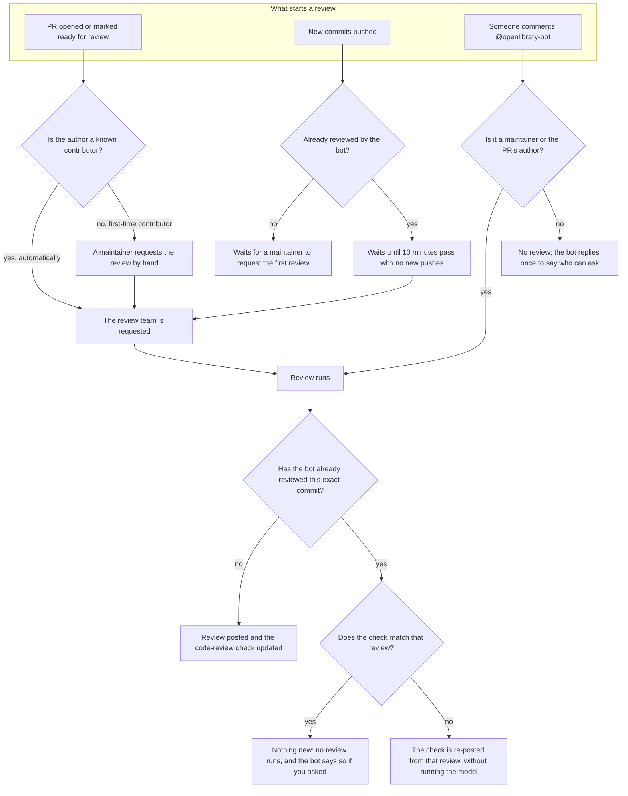
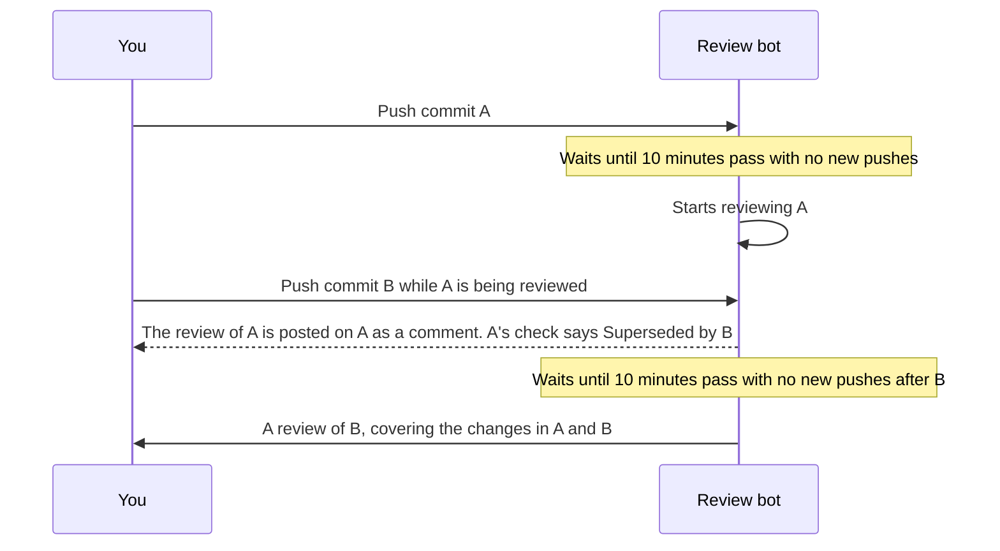
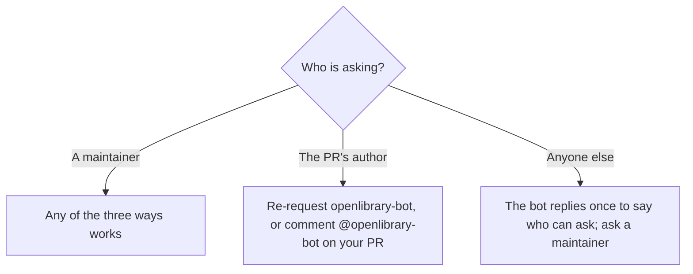
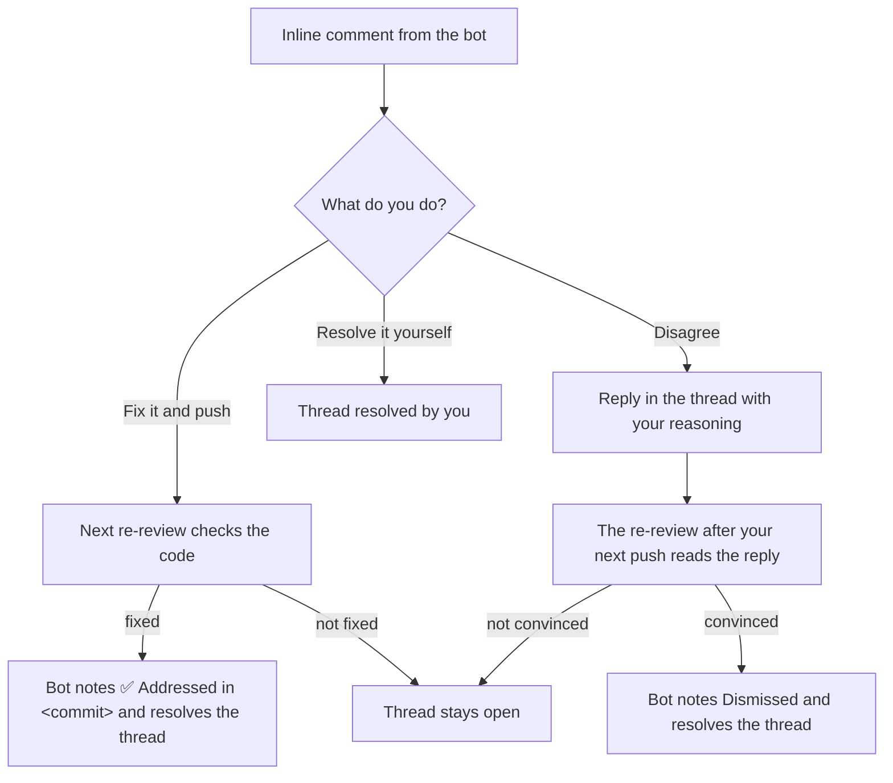
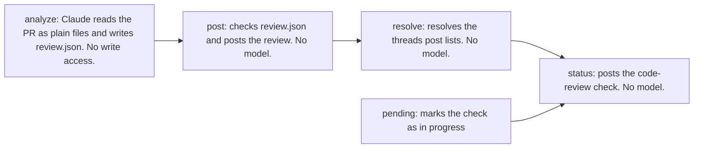

# How the code review bot works

`@openlibrary-bot` reviews pull requests on this repository with Claude. It leaves one review per
pass, with inline comments on the problems it finds, and posts the `code-review` check that a PR
needs to merge. This page explains when it runs, what it checks, and what to do with its feedback.

The bot is a first reader, not a maintainer. Its approval is not a sign-off or a security audit,
and a person still reviews and merges every PR.

## When it reviews

A review starts in one of these ways:

- **When a PR is opened or marked ready for review.** The review team
  (`openlibrary-agentic-code-reviewer`) is requested automatically if the author is a known
  contributor: an owner, member, collaborator or past contributor of this repository. A
  first-time contributor's PR waits for a maintainer to request the team, so drive-by PRs don't
  spend the bot's budget.
- **After new commits, once the pushes stop.** If the bot has reviewed the PR before, it reviews
  the new commits once 10 minutes pass with no further push (`push_review_delay_minutes` in
  [`.pr_agent.toml`](../.pr_agent.toml)). See [What happens when you push](#what-happens-when-you-push).
- **When someone asks.** Request a review from the `openlibrary-agentic-code-reviewer` team, use
  the re-request button next to `openlibrary-bot`, or comment `@openlibrary-bot` on the PR. The bot
  adds 👀 to your comment when the review starts.

It never reviews a draft or a closed PR. If you ask for a review and there's nothing to review (a
draft, a closed PR, or a commit it already reviewed), the bot replies to say so.

### What happens when you push

- **Another push within the 10 minutes** cancels the wait and starts it over, so the review starts
  10 minutes after your *last* push. A burst of commits gets one review.
- **A push while a review is running** doesn't stop that review or waste it. When it finishes, the
  bot posts it on the commit it read, marked as superseded, as a comment that neither approves nor
  blocks. That commit's check changes to "Superseded by `<commit>`". Your new commit waits its own
  10 quiet minutes, then gets its own review. That review also covers the changes the superseded
  one saw, so nothing it found is lost.
- **A force-push while a review is running** is the exception: the commit that review read is no
  longer part of the PR, so the review is dropped. The new head still gets its own review, of the
  whole PR.
- **Asking for a review during the wait** starts it right away instead.
- **Updating the branch from master** (the "Update branch" button, or merging master in) waits
  like any push. Then the bot re-reviews only files where you fixed a merge conflict by hand. If
  there were none, it doesn't run the model and the check gets the previous verdict.
- **No re-review** for pushes made by bots, or PRs labelled `no-automation`. Ask for a review if
  you want one.

### Who can ask for a review

Commenting works for the PR's author and for these maintainers: `mekarpeles`, `cdrini`,
`hornc`, `scottbarnes`, `seabelis`, `RayBB` and `lokesh`. The PR's author can also use the
re-request button next to `openlibrary-bot` in the Reviewers sidebar, once the bot has reviewed
the PR. Requesting the review team needs triage or write access to the repository. If anyone else comments
`@openlibrary-bot`, the bot replies once on that PR to say who can ask.

### What a re-review covers

A re-review looks only at the files changed since the bot's last review, so it doesn't repeat
itself. Commits that only merge the base branch in are skipped. If nothing but base-branch merges
arrived, no new review runs and the check keeps the previous verdict. Files the PR leaves exactly
as they are on master are skipped too, so master's changes stay out of the review even when they
reached the branch some other way than a merge, such as copied in by hand. After a force-push that
rewrites the history it reviewed, the bot reviews the whole PR again.

On each re-review the bot also re-checks its own open comments, as described in
[Responding to a finding](#responding-to-a-finding).

### If a review gets stuck or fails

If GitHub returns a server error (5xx) while the bot posts its review, the bot retries up to twice,
10 and 20 seconds apart. It first checks whether GitHub posted the review anyway, so it doesn't post
it twice. The job fails only if every attempt fails.

Ask again: comment `@openlibrary-bot`, or re-request the review.

- If the bot hasn't posted a review for the PR's latest commit (the review failed, or the check
  says "No clean review for this commit."), asking again runs a full review.
- If it has, asking again doesn't review the same commit twice. It re-posts the `code-review`
  check from that review if the check is stuck or out of date, without running the model.
- To get a fresh review of a commit the bot already reviewed, push a new commit.

A maintainer can also open the failed run in the Actions tab and use **Re-run failed jobs**.

## What it checks

Every review covers five areas:

| Area | What it looks for |
|---|---|
| Correctness | Bugs, unhandled edge cases, callers that rely on the old behaviour, blocking calls on the async path |
| Security | Anything touching auth, sessions, redirects, user input in SQL, shell, files or templates |
| Accessibility | Templates, JS and CSS against WCAG 2.1 AA: alt text, labels, keyboard access, contrast |
| Test coverage | A missing test that would catch a real bug, a test that can't fail, and tests that aren't worth keeping |
| Styleguide | Material problems only: unrelated edits, error-prone patterns, speculative abstractions |

It also checks the PR against the issues it links to and lists which of their requirements the
PR meets, doesn't meet, or needs a person to verify.

**Security concerns about existing code are never posted publicly.** Code already on `master`
may be live on openlibrary.org, so the bot holds back any concern about it, and anything else in
the review that reads as security-related. A concern about code the PR itself adds isn't live yet,
so the bot posts it like any other finding, on the line that adds it; a security finding always
blocks. If it isn't sure which kind a concern is, it holds it back.

When part of a review is held back, the rest is still posted, with a note saying some of it was
held back. If the held-back part blocks, the bot requests changes and the `code-review` check fails
with "Feedback withheld for maintainer review." It stays failed through later reviews, until a
maintainer has looked at the PR, dismissed that review, and commented `@openlibrary-bot review` to
refresh the check. The held-back text isn't sent anywhere: the bot keeps nothing that it can't post
publicly.

The full instructions the bot follows are in
[`.github/workflows/code_review.md`](../.github/workflows/code_review.md).

## What you'll see

**The review.** It opens with one status line, such as "**2 findings** · 1 suggestion on
`abc1234`", or "**No issues found**". Then:

- **Inline comments** for findings that should be fixed before merging, each headed with its
  severity and area, for example **MEDIUM · Correctness — …**. Where the fix is small, the comment
  includes a suggestion you can apply in one click.
- **Suggestions (won't block)** in the summary, for low-severity findings, findings the bot isn't
  sure about, and every test-coverage finding.
- **Prompt for AI agents**, collapsed blocks you can paste into a coding agent: one under each
  inline comment, and one in the summary covering everything the review found.
- **🎫 Linked issues**, collapsed, when the PR links to issues: which of their requirements the PR
  meets.
- **A last line with the next step:** address the feedback before a maintainer reviews the PR,
  or, when the bot found nothing, that a maintainer will review it next. Treat suggestions as
  feedback too, and use your judgement on each.

**The verdict.** The review is one of:

- **Request changes** when there is at least one finding that blocks.
- **Approve** when there are none and none of the bot's earlier comments are still open.
- **Comment** otherwise, and always on PRs the bot wrote itself and on a superseded review (one
  of a commit the PR moved past during the review).

**The `code-review` check.** This check is required to merge. It shows:

| Check | Message | Meaning |
|---|---|---|
| ⏳ pending | Review in progress. | The bot is reviewing this commit. |
| ⏳ pending | New commits. A review starts after 10 minutes with no more pushes. | A re-review starts when the pushes stop. |
| ⏳ pending | New commits since the last review. Re-request review from openlibrary-bot to review them. | This push doesn't start a re-review (for example, the PR is labelled `no-automation`). |
| ⏳ pending | Not reviewed yet. A maintainer can request review from openlibrary-agentic-code-reviewer. | No review has been requested yet. |
| ⏳ pending | Superseded by `<commit>`: the PR changed during the review. | New commits arrived mid-review. The review was posted on this commit; the newest commit gets its own review. |
| ❌ failure | N findings to address. | The review found problems that block. |
| ❌ failure | N unresolved review threads. | No blocking findings, but some review threads are still open. |
| ❌ failure | Feedback withheld for maintainer review. | Part of the review was held back. See the security note above. |
| ❌ failure | No clean review for this commit. | The review failed to post. Ask for a new review. |
| ❌ failure | Review findings count unavailable. | The review ran but its result couldn't be read. Ask for a new review. |
| ✅ success | Review passed; all feedback resolved. | Clean review, and no open threads. |

The check passes only when the latest commit has a clean review with no blocking findings, **and**
no review thread on the PR is unresolved, including threads people opened. A thread on lines that
a later push changed (GitHub marks it "outdated") doesn't count. After each new push, the check
waits for that commit's review.

## Responding to a finding

- **Fix it.** Push the fix. On the next re-review the bot checks the code. If it's fixed, the bot
  adds **✅ Addressed in `<commit>`** to its comment and resolves the thread. Threads are resolved
  by `github-actions`.
- **Disagree.** Reply in the thread and say why. On its next re-review the bot reads replies from
  the PR's author and the repository's members. If a reply shows the finding is wrong or out of
  scope, the bot notes **Dismissed** and resolves the thread. A reply that only asks it to dismiss
  isn't enough.

  The bot doesn't answer in the thread, and a reply alone doesn't start a re-review. Asking
  again doesn't help either, because the bot doesn't review the same commit twice. So the bot
  reads your reply only after your next push. If you have nothing more to push, resolve the
  thread yourself or ask a maintainer to.
- **Resolve it yourself.** The PR's author and anyone with write access can resolve a thread. Use
  your judgment; the bot can be wrong.

When the bot closes the last open finding of one of its earlier reviews, it edits that review to
open with **✅ Every finding in this review was fixed or dismissed.** and strikes through its old
status line. That way an old review never shows a problem that's already gone. Only the text
changes: the review's verdict stays as it was, and the bot never dismisses its own reviews. A
review with a finding that had no thread is left as it is, since the bot can't tell whether that
finding was fixed.

A few more things worth knowing:

- **Suggestions (won't block)** are in the review summary, not threads. Nothing to resolve: use
  them or don't.
- **Changing the lines under a comment** makes GitHub mark its thread "outdated". An outdated
  thread doesn't hold up the `code-review` check, but the bot still re-checks it and resolves it
  once the problem is fixed.
- **A finding the bot still sees** stays open; it doesn't post the same finding again.

If the bot gets something wrong in a way worth fixing, open an issue with the `Theme: Bots` label.

## Settings

The bot reads [`.pr_agent.toml`](../.pr_agent.toml) from the base branch, so a PR's changes to it
take effect after it merges. The file uses [PR-Agent](https://docs.pr-agent.ai/)'s format and key
names, though Open Library doesn't run PR-Agent itself.

| Setting | What it does |
|---|---|
| `handle_push_trigger` | Re-review after new commits (on) |
| `push_review_delay_minutes` | How long to wait with no new pushes before that re-review (10) |
| `push_trigger_ignore_bot_commits`, `push_trigger_ignore_merge_commits` | Skip pushes by bots, and pushes that only merge the base branch |
| `require_*_review` | Turn each review area on or off; security can't be turned off |
| `require_ticket_analysis_review` | Check the PR against its linked issues |
| `inline_key_issues` | Post findings as inline comments, or put them all in the summary |
| `num_max_findings` | Cap the findings per review |

## How it's built

The review runs in GitHub Actions, in separate jobs so that the job that reads the PR can't
write anything:

- **`analyze`** never runs the PR's code. It extracts the PR as plain files, and Claude can only
  read them and write `review.json`. It has no shell, no web access and no write access to the
  repository, so instructions hidden in a PR can change what the review says, but not what the
  workflow does.
- **`post`** re-checks `review.json` before posting: it posts nothing from a malformed review,
  and nothing security-related except a concern on lines the PR adds.
- **`resolve`** resolves the threads `post` lists, with a token that exists only while that job
  runs.
- **`status`** decides the `code-review` check from the posted review and the PR's live threads.

A weekly report on how the bot is doing runs on Sundays. It opens an issue only when something
needs attention, and always writes its numbers to the workflow run's summary.

| File | Purpose |
|---|---|
| [`.github/workflows/code_review_action.yml`](../.github/workflows/code_review_action.yml) | The review workflow |
| [`.github/workflows/code_review.md`](../.github/workflows/code_review.md) | The bot's instructions |
| [`.github/workflows/code_review_awaiting.yml`](../.github/workflows/code_review_awaiting.yml) | Marks new commits pending, and starts re-reviews after pushes |
| [`.github/workflows/auto_assign_reviewer.yml`](../.github/workflows/auto_assign_reviewer.yml) | Requests the review on new PRs |
| [`.github/workflows/code_review_report.yml`](../.github/workflows/code_review_report.yml) | The weekly report |
| [`.github/scripts/code_review/`](../.github/scripts/code_review/) | The scripts the workflows run |
| [`.pr_agent.toml`](../.pr_agent.toml) | Settings |
